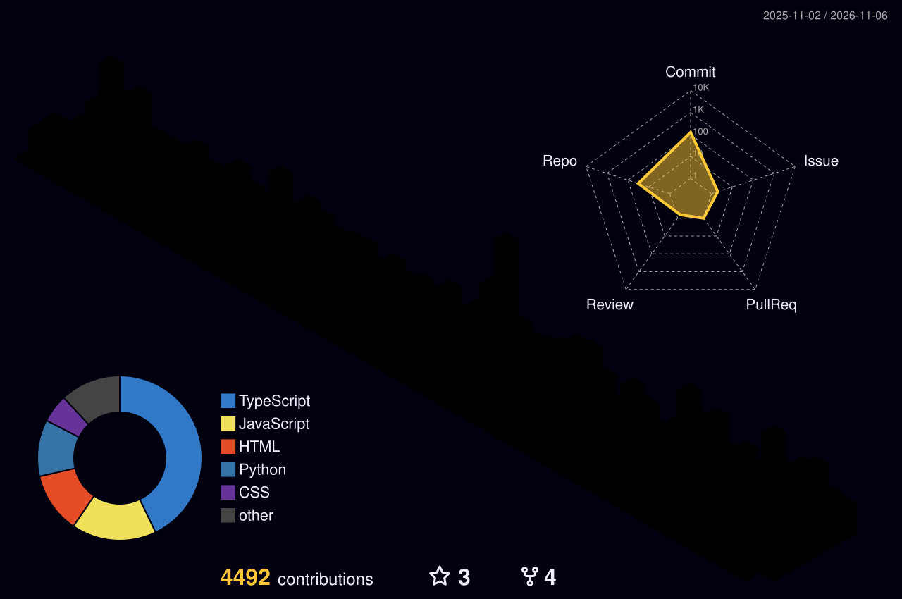

<!--
  ──────────────────────────────────────────────────────────────
  README de perfil — andersonodev
  Dica: as URLs abaixo foram todas testadas. Se alguma parar de
  responder no futuro, o motivo quase sempre é limite de uso do
  serviço gratuito (Vercel/Heroku), não erro de sintaxe.
  ──────────────────────────────────────────────────────────────
-->

<!-- ===================== CAPA ANIMADA ===================== -->

<!-- ===================== TEXTO DIGITANDO ===================== -->

 

<!-- ===================== CONTATO / SOCIAL ===================== -->

<!-- ===================== DIVISOR ANIMADO ===================== -->

##  Sobre mim

Desenvolvedor de Software, atualmente cursando **Engenharia de Computação no IBMEC**.

Tenho experiência em projetos pessoais com foco em desenvolvimento utilizando **Java** e **Spring Boot**, além de integração com bancos de dados. Também possuo domínio em **Python** e **C#**, tanto para desenvolvimento de aplicações quanto para análise de dados e aplicações de **Inteligência Artificial**.

-  &nbsp;Back-end, APIs REST e modelagem de dados
-  &nbsp;Estudando arquitetura de software e IA aplicada
-  &nbsp;Rio de Janeiro, Brasil
-  &nbsp;Movido a café

 

<!-- ===================== CONTRIBUIÇÕES EM 3D ===================== -->

  

##  Skills

### Linguagens de Programação, Estilo & Marcação

### Bibliotecas e Frameworks

### Ferramentas & Banco de Dados

 

##  Estatísticas GitHub

<!--
  ATENÇÃO — github-readme-stats
  As instâncias públicas (github-readme-stats.vercel.app e os mirrors)
  estão retornando 503 / "Maximum retries exceeded", por isso os dois
  cards antigos apareciam quebrados no seu perfil.
  Para voltar a usá-los, faça seu próprio deploy gratuito:
    1. Fork em https://github.com/anuraghazra/github-readme-stats
    2. Deploy na Vercel
    3. Crie a env var PAT_1 com um GitHub token (escopo: public_repo)
    4. Troque SEU-APP abaixo pelo domínio gerado e descomente

  
  

-->

###  Troféus

  <!-- domínio corrigido: github-profile-trophy.vercel.app está devolvendo 402 -->
  

###  Contribuições do ano

  

##  Animações de contribuição

<!-- Snake: agora com versão clara e escura (ambos os arquivos existem na branch output) -->
<picture>
  <source media="(prefers-color-scheme: dark)" srcset="https://raw.githubusercontent.com/andersonodev/andersonodev/output/github-contribution-grid-snake-dark.svg" />
  <source media="(prefers-color-scheme: light)" srcset="https://raw.githubusercontent.com/andersonodev/andersonodev/output/github-contribution-grid-snake.svg" />
  
</picture>

  

<!-- Pac-Man: só aparece depois que o workflow pacman.yml rodar uma vez -->
<picture>
  <source media="(prefers-color-scheme: dark)" srcset="https://raw.githubusercontent.com/andersonodev/andersonodev/output/pacman-contribution-graph-dark.svg" />
  <source media="(prefers-color-scheme: light)" srcset="https://raw.githubusercontent.com/andersonodev/andersonodev/output/pacman-contribution-graph.svg" />
  
</picture>

<!-- ===================== RODAPÉ ANIMADO ===================== -->

